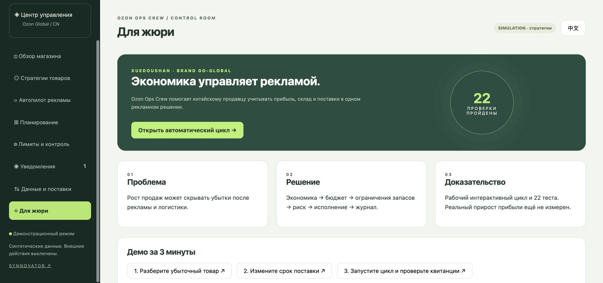
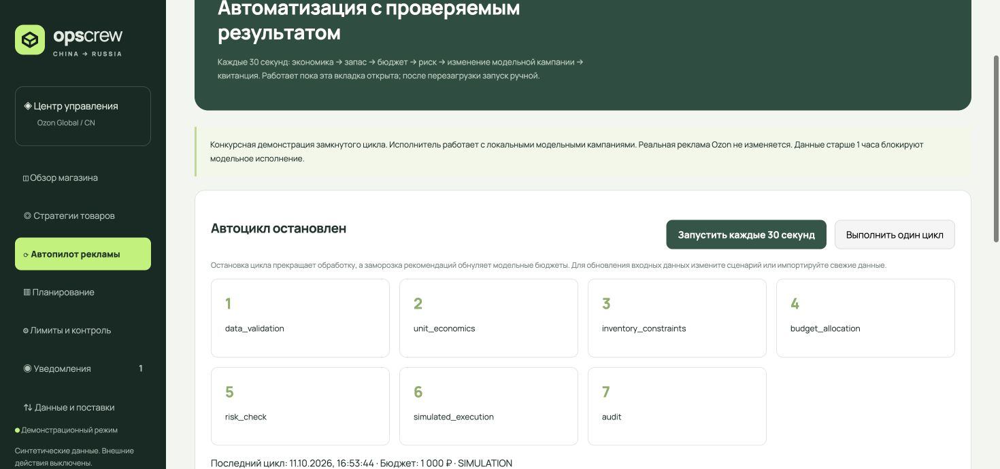
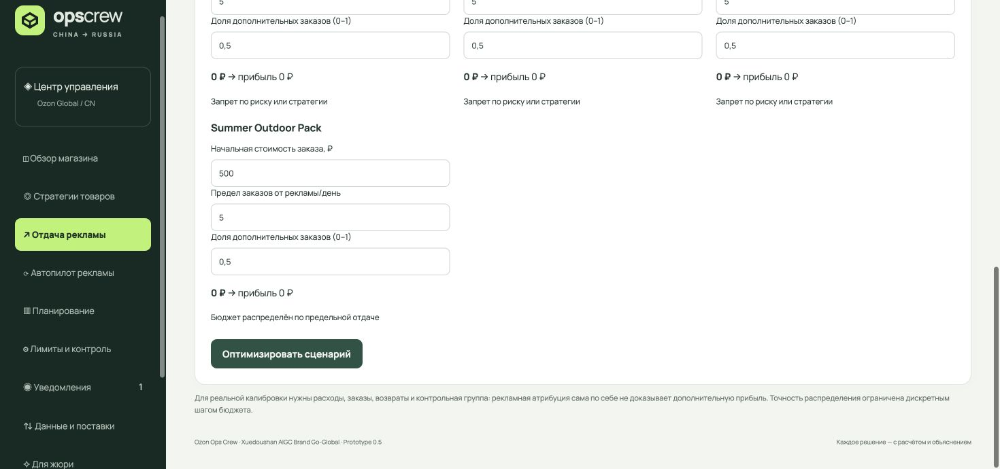
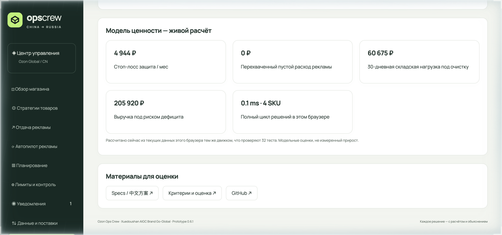

# Ops Crew · 中国卖家的 AIGC 图文工作台

[打开中文交互演示](https://arszs.github.io/ozon-ops-crew/) · [当前工作台开发分支](https://github.com/arszs/ozon-ops-crew/tree/feat/cross-border-workspace) · [AIGC 实现与验证边界](docs/AIGC-DEMO.md)

从买家评价出发，核对商品事实，生成俄语文案与图像编辑方案，再比较新旧图片、由卖家确认。公开演示使用真正生成的图片和合成商品，回放预先生成的结果，不连接或修改商店。

当前本地工作台已实现订阅生成文案、外部生成图片上传、版本记录与人工确认。xds.studio 采用手动工作流，尚未验证原生 API。生成图片不能修复产品缺陷；利润提升须另外实测。

## Локальная рабочая версия

Главная — рабочий обзор выбранного магазина: четыре экономических показателя, ближайшие решения и до пяти товаров с рекламой/экспериментами. Настройки и демонстрационные инструменты вынесены в «店铺管理». Прибыль без полной сверки затрат остаётся неизвестной; валюты и магазины не смешиваются.

Рекламные эксперименты: добавлен план отключения CPO одного SKU с чтением текущего состояния, подтверждением точных параметров и отдельной проверкой результата. Реальные чтения проверены; внешнее отключение не выполнялось. Включение CPO также реализовано через отдельный гейт; автоматическое соблюдение бюджетных ограничений пока не реализовано. Подробности — [LIVE-API](docs/LIVE-API.md#подтверждаемое-отключение-cpo-одного-sku).

MVP для китайского продавца: перенос товаров Taobao/Tmall → Ozon/Wildberries, управление магазинами и оценка экономики выхода на площадки.

```sh
npm test
npm start
```

Открыть http://127.0.0.1:4173. Главный интерфейс — на китайском, карточки и ответы покупателям — на русском. Требуется локальный Node-сервер; GitHub Pages не предоставляет API.

- Реальный Ozon: чтение каталога, экономики и рекламной статистики через существующее подключение. Подробности: [LIVE-API.md](docs/LIVE-API.md).
- Перенос: персистентный пайплайн, версии, доказательства, три гейта и изолированная симуляция публикации. Отдельный AI-сценарий использует подписку Codex для перевода/OCR и заменяет текст на PNG. Taobao API пока не подключён.
- Магазины Ozon/WB: отдельные профили, синхронизация доступных данных, планы цен/остатков/ответов. Создание новой карточки Ozon реализовано через гейт; реальная отправка ещё не проверена. RUB-цена из сохранённого эксперимента также имеет отдельный гейт и повторную проверку; реальная запись цены ещё не проверена. Для WB реализованы отдельные гейты создания карточки, загрузки изображений изменения цены в валюте API и остатков по складам/размерам с последующей сверкой; без реального WB-аккаунта проверены только на синтетических ответах. Реальная запись остатков Ozon и ответов покупателям пока не подключена.
- Результат SKU: начисления Ozon по датам + версионируемые фактические затраты продавца → сравнение дневного вклада в прибыль. Новые отчёты или затраты требуют пересчёта; вывод о причинном эффекте не делается. Себестоимость, налоги и общие расходы API не подтверждает.
- Оценка магазина: ссылка + образец ассортимента + явные предположения о расходах. По одной ссылке спрос и прибыль не выдумываются.
- Предыдущая лаборатория рекламных гипотез сохранена на `/legacy.html`; автоматического запуска рекламных стратегий нет.

[Перенос через подписку, результаты проверки и настройка публикации Ozon](docs/SUBSCRIPTION-PIPELINE.md).

[Архитектура, настройка, сценарий демо и честные ограничения MVP](docs/CROSS-BORDER-MVP.md).

## Площадки и расширение

Ozon — основной сценарий. Amazon / Shopify / Wildberries / TikTok Shop — будущие API-адаптеры; код предварительной интеграции WB сохранён. В «店铺管理» показаны статусы реализации отдельно от количества настроенных магазинов. Неизвестные и ещё не реализованные площадки не могут использовать обработчики Ozon/WB, в том числе в демо. [Контракт и условия подключения](docs/MARKETPLACE-ADAPTERS.md).

## История предыдущего прототипа

Ниже сохранена документация предыдущих версий; актуальные возможности описаны выше.

---

<div align="center">


# Ozon Ops Crew
### China → Russia · Inventory-aware profit control
**价格 × 广告 × 库存，一体化利润决策**

[**Open interactive demo / 打开演示**](https://arszs.github.io/ozon-ops-crew/) · [**Watch 3-min demo video**](docs/demo.mp4) · [中文参赛方案](docs/SUBMISSION.zh.md) · [Русское описание](docs/PROJECT.ru.md) · [Architecture](docs/ARCHITECTURE.md) · [Evaluation](docs/EVALUATION.md)

[](https://github.com/arszs/ozon-ops-crew/actions/workflows/ci.yml)
[](https://github.com/arszs/ozon-ops-crew/actions/workflows/pages.yml)
[](#run-in-30-seconds)
[](https://arszs.github.io/ozon-ops-crew/)

</div>

| Store overview | Advertising autopilot | Marginal ad profit |
| --- | --- | --- |
| [](https://arszs.github.io/ozon-ops-crew/) | [](https://arszs.github.io/ozon-ops-crew/) | [](https://arszs.github.io/ozon-ops-crew/) |

| Jury page with live value model / 评审页实时价值模型 |
| --- |
| [](https://arszs.github.io/ozon-ops-crew/) |

A control room for Chinese Ozon Global sellers: compare pricing and advertising strategies against stock, replenishment, storage costs and seasonal assumptions. Detect a rolling loss including advertising, freeze automated price changes and request a SKU-level advertising pause.

> **Prototype, not a production trading system.** All strategy and profit examples use synthetic data. The included local Seller API adapter reads the product catalog only. Price changes, advertising writes, automatic forecasting and production notifications are not implemented. No live performance improvement is claimed.

## Run in 30 seconds

Node.js 22.13+; run `npm install` (image processing uses Sharp). The large-catalogue cache uses built-in `node:sqlite`.

```sh
npm test
npm start
# http://127.0.0.1:4173
```

For read-only catalog access, put `OZON_CLIENT_ID` and `OZON_API_KEY` in a file **outside this repository**, restrict its permissions, and run:

```sh
OZON_ENV_FILE=/absolute/private/ozon.env npm start
```

Never paste credentials into the portal, source code, commits, screenshots or issue reports. GitHub Pages runs only the synthetic demo; it cannot call the local API. No credentials are included in this repository.

## Version 0.7.0

- The autopilot now executes the same marginal-return allocation shown on the efficiency screen; equal-budget uniform-vs-optimized comparison is displayed side by side.
- Loss protection is reported per observation window (sales records carry no dates); no monthly extrapolation.
- Cycle journal stores summaries and diffs only — no full campaign snapshots in browser storage.
- Reproducible business-value model (`node scripts/value-model.mjs`): the real engine scores a seeded 10,000-SKU portfolio in ~28 ms and aggregates the exposure its decisions address.
- Scale benchmark: full 2,000-SKU decision and autopilot cycles inside strict time budgets; decisions are deterministic.
- New jury documents: [scaling architecture](docs/SCALING.md), [value model](docs/VALUE-MODEL.md), [compliance](docs/COMPLIANCE.md), agent contract table in [architecture](docs/ARCHITECTURE.md).
- Add your own products, import sales windows and validated product JSON. Data stays in this browser and survives reloads.
- Store-wide allocation cap and persistent freeze switch for recommendations. These controls do not pause real Ozon campaigns.
- Unallocated advertising expenses trigger protection even without sales.
- Daily inventory forecast includes arrival quantity, missed demand, storage cost and additional purchase need.
- Demo snapshot stays fresh across reloads; imported datasets keep their own snapshot time.
- Bounded browser storage with safe persistence, plus a recorded 3-minute demo video.
- One-click 500-SKU stress portfolio in the Data page proves console fluency at scale; server allowlist regression guard.
- Export product data and decision records; 41 automated checks.

## Included

- Responsive Russian / Chinese management portal; no build required.
- Explainable strategy engine: limited test, seasonal hold, liquidation, stock protection, pause and settlement wait.
- Currency-aware unit economics with separate inbound / fulfilment / packaging / return provisions.
- Store defaults and SKU overrides, rolling-loss window and price-change limits.
- In-portal simulation notifications and decision audit history, stored in the current browser.
- Validated CSV scenario import/export; procurement batch schema for Excel.
- Local read-only Ozon Seller catalog adapter with bounded pages and request timeout.
- Chinese competition proposal, architecture with agent contracts, evaluation plan, reproducible value model, scaling and compliance documents, demo script and delivery checklist.
- Deterministic safety tests and GitHub Actions CI / Pages workflow.

## Competition

Existing entry: **Ozon Ops Crew — 评论驱动的 Ozon Global 商家运营 Agent 系统**.
This version focuses the operating-agent scope on **profit-aware pricing, advertising and inventory**, preserving the existing entry name. Review-response automation is not implemented in this prototype.

[Q3 Brand Go-Global track](https://www.synnovator.com/hackathon/hfhahkjfdhakfhf) · [Existing entry](https://www.synnovator.com/arszlx/ozon-ops-agents)

Verified 2026-10-11: submission through **October 12**, preparation **October 13–16**, offline final **October 24–25**. Closing time/timezone is not stated. The top UI's October 16 results date conflicts with the detailed final schedule; use organizer confirmation for attendance.

## What the demo proves

The engine recomputes strategy decisions as storage, seasonal assumptions, stock or replenishment time change. It demonstrates why top-line growth can destroy profit and why increasing advertising before a stockout can be irrational. It does **not** prove demand causality, model accuracy or actual financial uplift.

## Before production

See [integration plan](docs/INTEGRATION.md). Implement settlement reconciliation, actual purchase batches, campaign-to-SKU allocation, real spend enforcement, persisted server-side notifications and authenticated user access. Validate Chinese-account Performance API permissions separately. Run shadow mode and a bounded pilot before enabling writes.

## Project structure

`web/` portal + pure decision engine · `server.mjs` localhost server · `ozon.mjs` read-only adapter · `tests/` safety scenarios · `docs/` competition packet · `templates/` procurement schemas.

## Rights and privacy

Original project source prepared for the owner. No third-party seller data, API keys, customer identifiers, account catalog exports or claimed proprietary Ozon assets are included. Ozon is referenced to describe integration compatibility; this is not an official Ozon product. No open-source license is granted until the owner selects one.

## Version 0.3 — economics-driven advertising loop
The Autopilot screen runs a deterministic agent workflow every 30 seconds while the browser tab is open: data validation → unit economics → stock constraints → budget allocation → risk checks → local simulated campaign execution → receipts. Repeated unchanged decisions are idempotent. Data older than one hour pauses the simulated campaigns. Reload does not auto-resume the loop. 22 automated tests pass.

This is an executable competition demonstration, not live Ozon advertising automation. Real activation requires separately verified Performance API access, complete actual costs, campaign membership checks, a persistent server worker and merchant-approved operating limits. No live uplift is claimed.

## Version 0.5 — marginal advertising profit
The Advertising Return screen allocates a capped daily budget using a diminishing-response scenario curve, incremental order share and unit contribution after a conservative storage allowance. It leaves inefficient budget unspent, excludes risk-blocked SKUs and requires at least 1.20 RUB incremental contribution per RUB spent. This is a discrete scenario optimizer, not a trained forecast or causal proof. Its output does not alter the automatic simulator or live campaigns. 29 tests pass.

## Version 0.5.1 — resilience and presentation
- Local persistence is capped (200 notifications, 500 audit records) and survives a full browser storage: the portal keeps working and warns instead of crashing.
- README gains CI/deploy badges and interface screenshots; the demo page ships description and Open Graph tags for link previews.

## Version 0.5.2 — demo freshness and video
- Demo-mode data no longer goes stale after reload: the freshness timestamp is restored only for user-imported data, so the public autopilot demonstration keeps running instead of pausing every campaign after one hour.
- Three-minute recorded walkthrough added at [docs/demo.mp4](docs/demo.mp4); minor bilingual copy fix.
