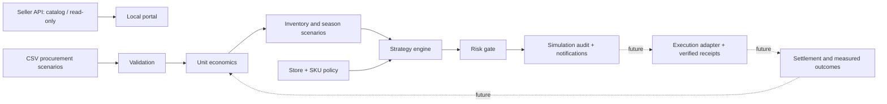

# Architecture and control contract

## Implemented boundary
`engine.mjs` is pure JavaScript with deterministic outputs. `app.mjs` provides RU/CN UX, browser-local policy and audit persistence; scenarios reset on reload. `server.mjs` serves explicit file and API allowlists on loopback only. `ozon.mjs` makes one read-only catalog request at a time. Public static deployment contains synthetic data only.

## Production design (not yet implemented)
PostgreSQL stores seller-isolated batches, orders, settlements, campaign membership, policy versions, decisions and execution receipts. A worker ingests paginated changes with cursor checkpoints, idempotency and backoff. Each decision records observation window, data freshness, evidence, policy version, candidate options and rejection reasons.

Ledger entries: order_id, SKU, batch_id, currency, exchange_rate_date, amount, fee_type, effective_at, ingested_at, settled. Reconcile actual fees and returns; never mix modeled return provisions with actual refunds twice. Allocate campaign spend by measured SKU attribution, retaining an explicit unallocated pool. Include zero-sale spend in time-window safety controls.

Execution state machine: proposed → validated → queued → sent → confirmed / failed / unknown. Timeout is not success. Reconcile current platform state before retry. A SKU pause must account for shared campaigns; never disable unrelated products accidentally. Use locks, idempotency keys, daily cumulative change caps, cooldown and manual reset after a loss trip.

Seasonality: Russian-market history is a prior only. Never transfer Russian-account costs to the Chinese account. For sparse data, use bounded exploratory spend and report uncertainty. Stockout-censored sales are not treated as low demand. Future optimization needs demand distributions and sell-through probability, not a price multiplier alone.

## Known simulator simplifications
Hold compares hypothetical future unit contribution, not expected whole-inventory discounted profit. History threshold is a heuristic, not validated statistical confidence. `maxPriceChange` limits a single scenario recommendation; production needs a rolling 24-hour cumulative cap. Per-SKU budgets are not an aggregate store budget scheduler. The portal does not autonomously execute or learn.
