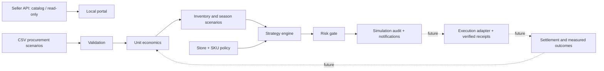

# Architecture and control contract

## Implemented boundary
`engine.mjs` is pure JavaScript with deterministic outputs. `app.mjs` provides RU/CN UX, browser-local policy and audit persistence; scenarios reset on reload. `server.mjs` serves explicit file and API allowlists on loopback only. `ozon.mjs` makes one read-only catalog request at a time. Public static deployment contains synthetic data only.

## Agent contracts / 智能体契约

Each pipeline stage is an explicit contract with declared inputs, tools, outputs and the human gate that bounds its authority. This is the agent design the judging rubric asks for: the deterministic rule engine holds all write authority; LLM assistance is additive explanation only.

| Agent 智能体 | Inputs 输入 | Tools 工具调用 | Outputs 输出 | Human gate 人工边界 |
|---|---|---|---|---|
| Data Steward 数据管理 | Catalog pages, procurement CSV, settlement rows | Read-only Seller API, CSV validator (`validateProducts`) | Validated ledger rows; rejects malformed input without partial writes | Import limits reviewed by merchant |
| Economics 单元经济 | Ledger rows, FX, fee params | `economics()` currency/fee math | Per-SKU contribution, break-even, allocated ad cost | Fee parameters merchant-confirmed |
| Inventory & Demand 库存需求 | Stock, inbound batches, history depth | `forecast()` day-by-day simulation | Stock days, missed demand, reorder qty, uncertainty label | Season assumptions editable |
| Strategy 策略 | Economics + inventory + policy | `evaluate()` candidate comparison | Strategy + proposed price + ad budget + reason codes | Store/SKU caps and freeze switch |
| Risk Sentinel 风控哨兵 | Rolling settled P&L incl. ads, unallocated spend | Loss-window trip logic | Price freeze + ad pause proposal | Loss limit set by merchant; manual reset |
| Execution & Audit 执行与审计 | Approved decisions | Simulation receipts today; verified API receipts later | Append-only decision journal, notifications | Real writes disabled until merchant approves limits |

任务流程：`data_validation → unit_economics → inventory_constraints → budget_allocation → risk_check → simulated_execution → audit`（自动 pilot 每 30 秒显式执行并记录该阶段序列，见 `web/autopilot.mjs`）。人机协作：商家设定限额与冻结开关，引擎在限额内行动，超限即拒绝并给出原因（`blocked` 字段），所有决策可导出复盘。

## Production design (not yet implemented)
PostgreSQL stores seller-isolated batches, orders, settlements, campaign membership, policy versions, decisions and execution receipts. A worker ingests paginated changes with cursor checkpoints, idempotency and backoff. Each decision records observation window, data freshness, evidence, policy version, candidate options and rejection reasons.

Ledger entries: order_id, SKU, batch_id, currency, exchange_rate_date, amount, fee_type, effective_at, ingested_at, settled. Reconcile actual fees and returns; never mix modeled return provisions with actual refunds twice. Allocate campaign spend by measured SKU attribution, retaining an explicit unallocated pool. Include zero-sale spend in time-window safety controls.

Execution state machine: proposed → validated → queued → sent → confirmed / failed / unknown. Timeout is not success. Reconcile current platform state before retry. A SKU pause must account for shared campaigns; never disable unrelated products accidentally. Use locks, idempotency keys, daily cumulative change caps, cooldown and manual reset after a loss trip.

Seasonality: Russian-market history is a prior only. Never transfer Russian-account costs to the Chinese account. For sparse data, use bounded exploratory spend and report uncertainty. Stockout-censored sales are not treated as low demand. Future optimization needs demand distributions and sell-through probability, not a price multiplier alone.

## Known simulator simplifications
Hold compares hypothetical future unit contribution, not expected whole-inventory discounted profit. History threshold is a heuristic, not validated statistical confidence. `maxPriceChange` limits a single scenario recommendation; production needs a rolling 24-hour cumulative cap. Since 0.7 the store budget is allocated by the marginal-return optimizer shared with the efficiency screen, not proportionally. It does not enforce actual spend or schedule real campaigns. The portal does not autonomously execute or learn.
