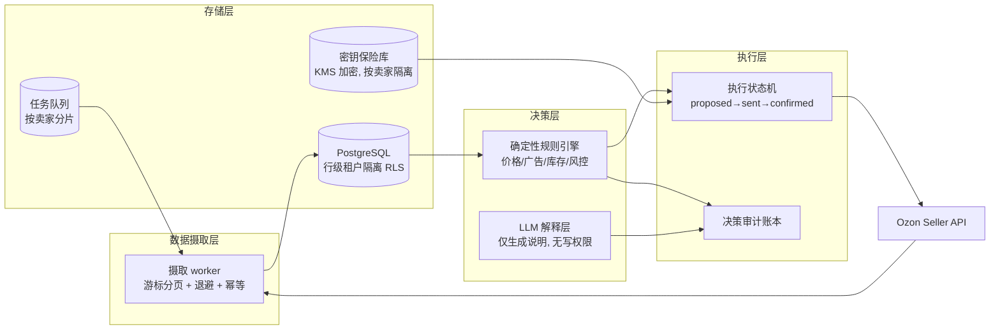

> Historical / exploratory reference. For the 2026-10-23 contest edition use [CONTEST-RELEASE.md](CONTEST-RELEASE.md), [ARCHITECTURE.md](ARCHITECTURE.md) and [COMPLIANCE.md](COMPLIANCE.md). Models and future designs below are not measured seller results or deployed production features.

# 规模化方案：服务数千中国跨境卖家 / Scaling to thousands of sellers

评审规则「创新性与可扩展性」要求说明方案能否复制到更多品牌、市场、平台与业务场景。本文件给出从当前原型到多租户服务的具体路径。当前原型为单机浏览器演示；以下为生产设计，按阶段实施，不声称已经实现。

## 1. 目标规模与负载估算

| 维度 | 试点期 | 增长期 | 目标期 |
|---|---:|---:|---:|
| 卖家数 | 20 | 500 | 5,000+ |
| SKU 总数 | 2,000 | 100,000 | 1,000,000+ |
| 每日决策轮次 | 每 SKU 1 次 | 每 SKU 4 次 | 事件驱动 + 每 SKU 4 次 |
| 每日平台 API 调用 | <10 万 | <300 万 | 按平台配额排队 |

决策引擎实测吞吐 ≈35 万 SKU/秒/核（见 VALUE-MODEL.md），**计算不是瓶颈**；瓶颈在数据摄取、平台 API 配额与多租户隔离，架构设计围绕这三点展开。

## 2. 多租户架构

- **租户隔离**：PostgreSQL 行级安全策略按 seller_id 隔离；密钥按卖家单独加密存储于 KMS 保险库，应用进程不持久化明文。
- **摄取**：每卖家独立游标与配额桶；失败按指数退避重试；幂等键防止重复入账。
- **决策**：规则引擎无状态、可水平扩展；每个决策记录观测窗口、数据新鲜度、证据、策略版本、候选方案与拒绝原因（当前原型已实现该审计结构）。
- **LLM 的角色**：仅用于解释决策与需求叙述分析，**不直接改写价格或预算**；所有写动作仍经确定性规则与人工限额校验。这是人机协作的核心边界。
- **执行**：状态机 + 平台回执校验；暂停共享广告活动前先校验 SKU 关联；超时不等于成功。

## 3. 单卖家服务成本（估算，目标期）

| 项目 | 估算 |
|---|---:|
| 存储（订单/结算/决策账本，保留 2 年） | ≈2 GB/卖家 |
| 摄取与决策计算 | <0.01 核时/卖家/天 |
| LLM 解释（可选，按需） | 按调用量计费，可关闭 |
| 边际基础设施成本 | **<5 元/卖家/月** 量级 |

低边际成本 + 浏览器端控制台 = 可按 SaaS 订阅定价，对中小跨境卖家可负担。

## 4. 可复制性：品类、市场、平台

- **品类**：引擎不区分品类，费率与履约参数全部数据化；新品类仅需校准佣金、仓储与退货参数。
- **市场**：俄罗斯之外可扩展至哈萨克斯坦、白俄罗斯等欧亚经济联盟市场；汇率与税费模型已按币种独立核算。
- **平台**：决策逻辑与平台解耦；接入新平台（Wildberries、Yandex Market、速卖通、Temu）只需实现对应的数据摄取与执行适配器，引擎与审计账本复用。每个平台需独立验证费率、API 权限与平台规则后才开放写入。
- **场景**：同一引擎可服务品牌自营店、分销代运营与多店铺聚合运营商。

## 5. 落地路线图

1. **试点（现在–Q1）**：20 个种子卖家，影子模式运行，按 EVALUATION.md 度量 reconciliation 误差与人力节省；写入仍默认关闭。
2. **受控写入（Q2）**：单 SKU 价格与预算小步写入 + 平台回执校验 + 人工限额；公布试点样本量与区间。
3. **多租户 SaaS（Q3）**：RLS 隔离、密钥保险库、队列化摄取上线；开放 500 卖家。
4. **多平台复制（Q4 起）**：按平台逐个接入与验证。

## English summary

Scaling path from prototype to multi-tenant SaaS: stateless deterministic engine (measured ≈350k SKU decisions/s/core, not the bottleneck), PostgreSQL row-level tenant isolation, per-seller KMS credential vault, cursor-based ingestion workers with backoff and idempotency, execution state machine with platform receipts, LLM strictly limited to explanations while deterministic rules and human limits guard all writes. Marginal infrastructure cost estimated at <¥5/seller/month. Replicable across categories, EEU markets and additional platforms (Wildberries, Yandex Market, AliExpress, Temu) via adapter pattern, each platform independently validated before writes are enabled.
